# Purchase-to-pay process mining: where invoices stall and rules break

> **Status: in progress.** Parts 1 to 4 of 5 are done (source and profile, compliance, bottlenecks, rework and automation). See the [plan](#plan).

A company's purchase-to-pay process is meant to be simple: raise an order, receive the goods, match
the invoice, pay. In a real ERP system it rarely is. This project uses **process mining** on a real
event log of 1.6 million events, using DuckDB SQL and Python, to answer the questions a procurement
or accounts-payable lead and an internal auditor would ask:

1. **Compliance:** are invoices paid only after the checks their flow requires?
2. **Bottlenecks:** where do items wait, and is that wait in the process or in the payment calendar?
3. **Rework:** how often are orders and invoices changed, cancelled or redone?
4. **Automation:** which steps, vendors and spend areas would repay fixing first?

It ties to business analysis and digital transformation: instead of asking people how a process
works, it measures what the system recorded.

## Data

| | |
|---|---|
| Dataset | [BPI Challenge 2019](https://doi.org/10.4121/uuid:d06aff4b-79f0-45e6-8ec8-e19730c248f1), from 4TU.ResearchData |
| What it is | Purchase-order handling at a large multinational in coatings and paints, based in the Netherlands |
| Size | 251,734 purchase items, 76,349 purchase documents, 1,595,923 events, 42 activities |
| Period | Mainly 1 Jan 2018 to 18 Jan 2019 |
| Licence | CC BY 4.0. Citation: van Dongen, Boudewijn (2019). BPI Challenge 2019. 4TU.ResearchData. Dataset. |
| In this repo | `data/events.csv.gz` and `data/cases.csv.gz` (11.8 MB), parsed from the raw log with nothing filtered or corrected |

**Getting the raw log:** `scripts/download_data.py` tries 4TU.ResearchData, then figshare, then a
public GitHub copy, and keeps a file only if its contents match the MD5 published with the
dataset. When this was built, 4TU timed out and figshare returned errors from the build machine,
so the raw log came from the [GitHub copy](https://github.com/Gength/generalization_analysis). Its
MD5 matches exactly, as do all 5 counts in the dataset's description. The Internet Archive's
capture was rejected, as it holds only the first 1 MiB. You don't need the raw log to run the
analysis.

## Part 1: what the log can and can't tell us

Full results, with every rule for the later parts: [`results/SOURCE_PROFILE.md`](results/SOURCE_PROFILE.md).

Before asking what the process does, this part checks what the data means. That turned out to
matter: **seven plausible readings of this log are wrong**, and several would pass unnoticed.

| Trap | What the data shows | Rule from here on |
|---|---|---|
| **The value field isn't real money, and doesn't add up** | Values are anonymised, so only shares hold. Summing the field gives 28.55 billion, 28.6 times the 0.997 billion you get counting each item once. 19 of the 25 common activities, including `Clear Invoice` and even `Change Price`, just repeat the same value. | Count each item once. Report shares. |
| **Some dates are wrong, and vendor dates aren't times** | 327 events fall outside the main span, as early as 1948. Vendor events all sit at 23:59 Dutch time, switching exactly with daylight saving. | Treat them as dates, not times. |
| **Requisition records jump** | 136-229 a month to August, then 11,422 in September, while POs hold steady. The log doesn't say why. | No "PO without requisition" trend across the break. |
| **The log just stops** | Cleared share falls from 92-94% in early 2018 to 5% for December, because the median PO takes 79.1 days to reach first clearing. | Measure on items with enough follow-up. |
| **A named account isn't always a person** | `user_002` clears 85.6% of invoices on 94 days, and 97.0% of named clearing happens in bursts of 50+ events in one minute. | "Named" doesn't mean "manual". |
| **Ties and repeats inflate paths** | 11,973 paths as logged. Collapsing immediate repeats leaves 7,246. | Treat path counts as a guide. |
| **A few items flood event counts** | 164,975 service entry sheet events sit on 5,604 items. | Count items, not events. |

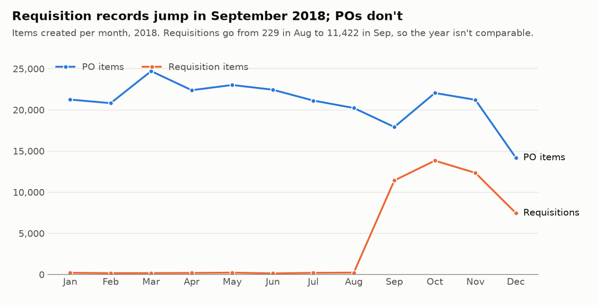

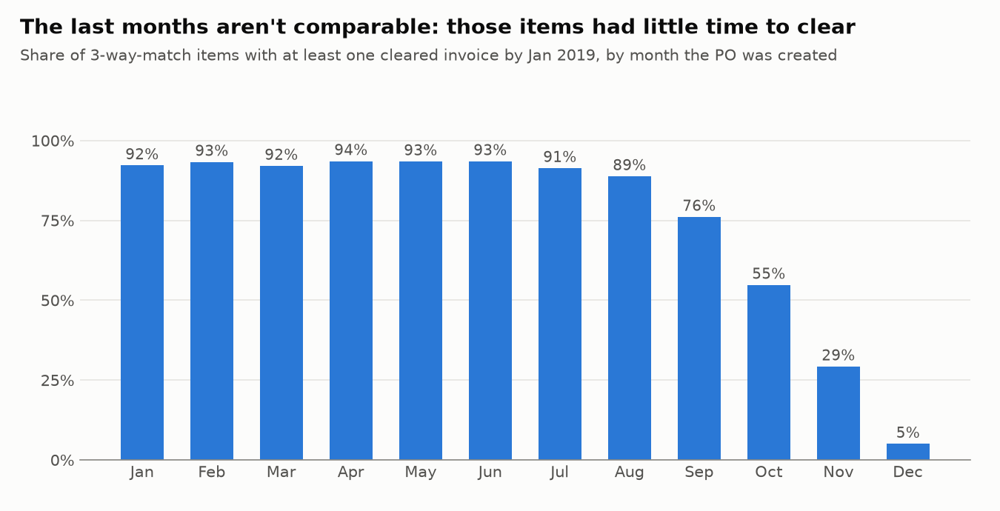

**The process has a clear core and a long tail.** The top 10 paths cover 59.5% of items, the top 100
cover 86.2%, and 9,030 paths were followed by a single item.

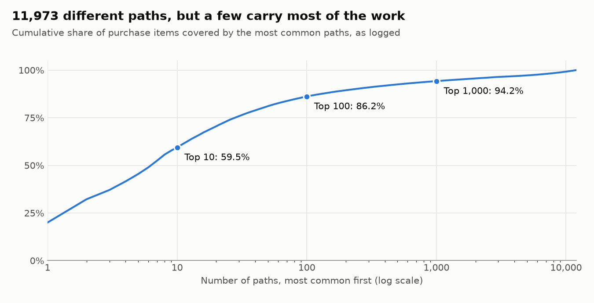

**Two leads for the next part,** on items with at least 6.5 months of follow-up. The share with at
least one cleared invoice differs a lot by flow: 94.0% for 3-way invoice-before-receipt (the
main flow, 87.8% of items), 78.5% for 3-way invoice-after-receipt and 28.6% for 2-way match (88 of
308 items). Part 2 explains the gap.

### So what for the business?

- **Trust this log for counts and shares, not for euros.** It can show which rules were followed,
  where items wait and how often work is redone. It can't size the money at stake in real
  terms, and its clearing events don't show what was actually paid. Any savings figure would need
  real amounts from finance.
- **A dashboard built on the raw fields would have misled.** It would have shown spend 28 times too
  high, a slowdown at year-end that's really the log stopping, and one person doing most of the
  invoice clearing.
- **Ask the process owner one question first:** what changed with requisitions in September 2018?
  The answer decides whether later compliance figures can cover the whole year.

## Part 2: which rules held, and which need a closer look

Full results: [`results/COMPLIANCE.md`](results/COMPLIANCE.md). Every rule:
[`results/compliance_rules.csv`](results/compliance_rules.csv). Items to check:
[`results/review_list.csv`](results/review_list.csv).

This part tests 21 rules on the 134,633 items created from January to June 2018, which had at least
6.5 months to finish. Some rules come from the publisher's description of each flow, and others are
standard audit tests the publisher doesn't state. Each rule was also run on items from July to
September as a second check.

**The controls held.** 10 of the 21 rules have no failures in either window. No invoice-after-GR item
was invoiced or cleared ahead of its goods, nothing was received or invoiced before its PO, and
no named account works on both purchasing and invoice processing.

**The alarming numbers mostly shrink.** A plain count finds 432 main-flow items cleared with no goods
standing. On 381 of them the invoice was reversed as well, so there's nothing left to pay, and that
leaves 51 (0.05% of cleared main-flow items). The same step cuts 1,934 "same account recorded and
cleared the invoice" items to 51, because nearly all involve a cancellation or debit memo. Treating
those corrections as clearing an invoice is an inference, as the log has no payment amounts.

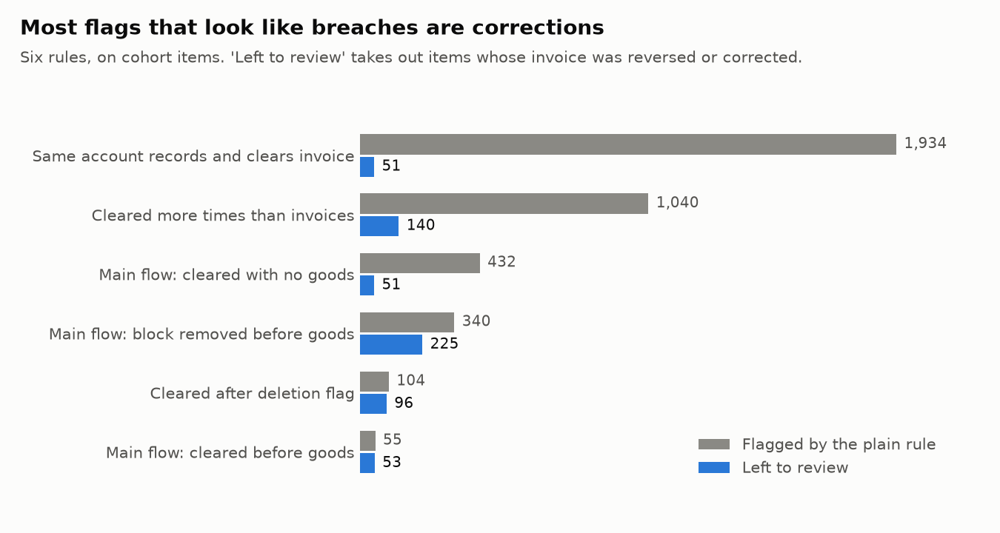

| Rule | Flagged | Left to review | Share of items it applies to | Share of value |
|---|---|---|---|---|
| Main flow: cleared with no goods standing | 432 | 51 | 0.05% | 0.08% |
| Main flow: cleared before the first goods receipt | 55 | 53 | 0.05% | 0.24% |
| Main flow: payment block removed before goods | 340 | 225 | 0.72% | 1.02% |
| Cleared after the item was flagged deleted | 104 | 96 | 0.08% | 5.68% |
| Cleared more times than invoices recorded | 1,040 | 140 | 0.12% | 0.21% |
| 3-way flows: vendor invoice over 7 days older than the PO | 1,766 | 1,247 | 1.06% | 4.87% |
| Same account raised the PO and recorded the goods | 2,706 | 2,673 | 2.08% | 12.85% |

Three rows deserve a closer look because their share of value is well above their share of items.
The same account raising the PO and recording the goods is 2.08% of items but 12.85% of value. 96
items cleared after a deletion flag hold 5.68% of value, though a deletion flag can legitimately
close out a delivered line. And half of the items with an invoice over 7 days older than the PO sit
with one vendor.

**The clearing gap comes from a few groups.** That answers the question Part 1 left open.

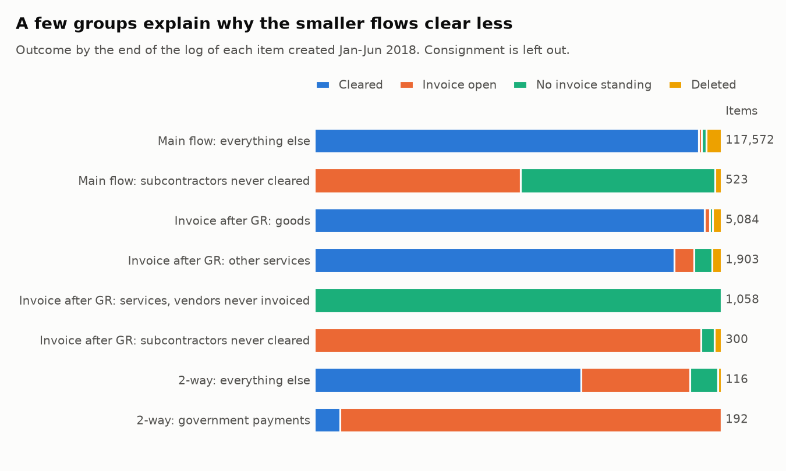

- **Invoice-after-GR clears at 78.5%, but 93.8% without two groups,** against 94.4% on the main flow
  once its own group is set aside. Those two groups are 1,358 items at 11 vendors, or 76% of the
  flow's uncleared items. These vendors were picked because nothing of theirs cleared, so they show
  where the gap sits, not why.
- **Services from 9 logistics vendors are received but never invoiced.** Their 1,058 items all have
  service entry sheets and no invoice on the PO. They were chosen on the cohort alone, and on 536 later items they
  still show no invoice. It looks like settlement outside this process, but the log can't confirm that.
- **4 subcontractors get a late automated invoice.** A batch account records it, a median 183 days
  after the PO, and none has cleared. The log stopping explains only part of this: 308 of the 561
  invoices are already older than the 95 days within which 90% of other subcontracting invoices clear.
- **The 2-way flow is one company and one login.** All 1,044 items belong to one company and were
  raised by `user_602`, and 88% of cohort invoices are dated before the PO. Government payments are
  192 of the 308 cohort items and only 12 have cleared, so 180 invoices are open. Even without them
  the flow clears at just 65.5%.

### So what for the business?

- **Don't redesign the controls.** The system enforces the invoice-after-GR order, and purchasing
  and invoice processing are separated. All 3 main-flow rules fail on under 1% of items, which calls for
  a targeted review.
- **Start with the review list.** It has 4,695 items (3.5% of items, 15.6% of cohort value), and 241
  of them fail two or more rules. These are items to check, not proven breaches.
- **Filter out reversals before reporting a breach.** A dashboard that counts `Clear Invoice` as
  "paid" would overstate "cleared with no goods" about 8 times.
- **Ask finance one question about what's outside this log:** are the logistics services, the
  subcontractors and the 2-way government payments settled somewhere else? If so, most of the gap
  disappears. If not, invoices are sitting open for months: a median 288 days on the 2-way flow.

**What this can't show:** the publisher's rule that values must match can't be tested, because the
value field is stamped on each event. The log also shows no approval limits, payment dates or
bank payments. Same-day events count as in order, so a same-day breach would be missed.

## Part 3: where items wait, and why

Full results: [`results/BOTTLENECKS.md`](results/BOTTLENECKS.md). Supporting tables:
[`results/wait_stages.csv`](results/wait_stages.csv), [`results/run_calendar.csv`](results/run_calendar.csv)
and [`results/vendor_terms.csv`](results/vendor_terms.csv).

Invoices look slow: a median of 65 days from invoice date to clearing. But a process map only shows
where time passes, not whether anything is stuck. This part splits that time into what's agreed,
what's scheduled and what's actually late, on the 3-way items created from January to June 2018.

**Most of the wait looks agreed or scheduled, not stuck.** On 105,356 items, the mean 83 days from PO
to first clearing breaks down like this, and only 13.8% of items were unfinished when the invoice fell due:

| Part | Mean days | Share |
|---|---|---|
| PO to the vendor's invoice date | 13.6 | 16.3% |
| Implied payment term | 51.2 | 61.6% |
| Process overrun | 4.1 | 5.0% |
| Waiting for a payment run | 14.2 | 17.1% |

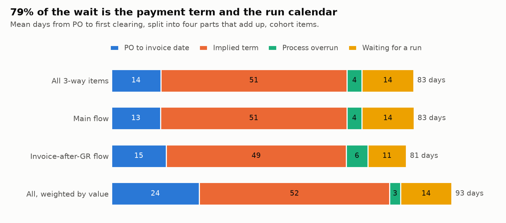

**The log has no payment terms, so they're implied.** A vendor's term here is the time from invoice
date to clearing on its fastest 5% of invoices. That's an inference, so it was tested. Set on January to
March invoices only, the term moves a week or less for 171 of 181 vendors in April to June, and
4.7% of later invoices beat it, close to the 5% expected. Setting it at the fastest 1% or 10% moves
the run wait only between 12.2 and 16.1 days.

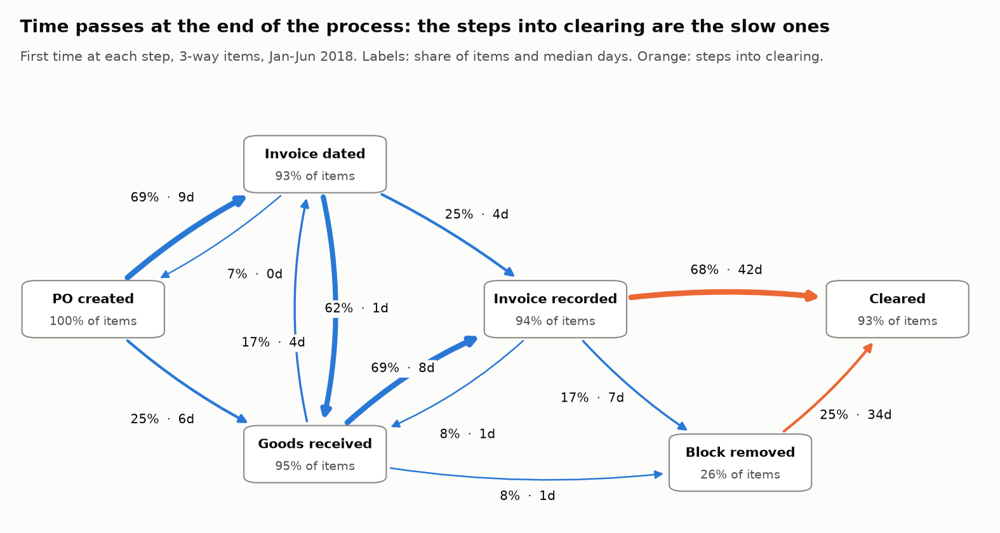

**Payment runs set the rhythm.** 20 days hold 79.9% of all clearing events, and 81.2% of items first
cleared on a main run. There are two main runs a month, and 126 of 148 larger vendors sit mostly in one of
them. A monthly run would mean about 15 days' wait on average, close to the 14.2 measured.

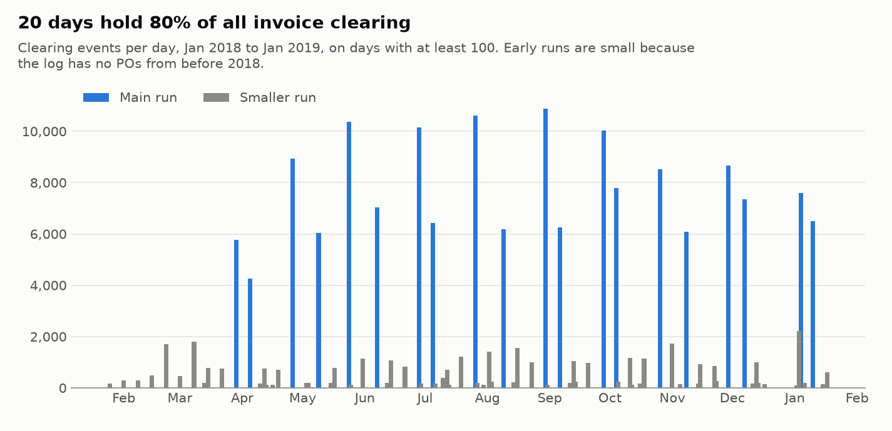

**There was no slowdown.** Taking the median of cleared items suggests clearing got much faster late in
the year, but that's just the log stopping. A Kaplan-Meier estimate, which counts items still open, stays at
81-87 days from January to September.

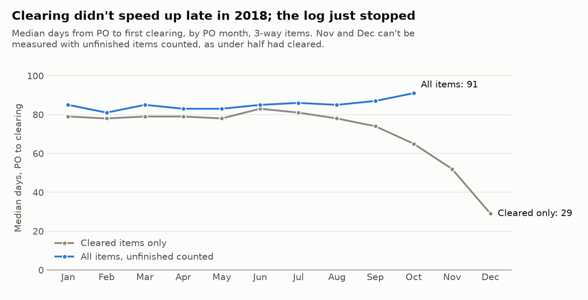

**Payment blocks are the main real hold-up.** They cause 61.7% of overrun days. The invoice-before-goods rule explains
only 34.7% of blocks, and those show no added wait against comparable items. Another 48.4% of blocks have no
reason visible in the log, and those add about 7 days.

### So what for the business?

- **Don't report invoice-to-clearing time as a process bottleneck.** Most of it is the term and the
  run calendar, so a team sent to fix it would be working on the wrong thing.
- **The payment calendar is a treasury decision.** Weekly Thursday runs would cut the wait from
  14.2 to 2.3 days. Vendors would be paid 11.8 days sooner, and cash would leave 11.6 days sooner, weighted by value. That's a
  trade-off, not a fix.
- **The real process work is narrow.** Sales is 28.4% of items but 47.5% of overrun days, and 10 vendors hold 45.2%
  of them. Start with the unexplained blocks and late invoice recording there.
- **Ask for one thing first:** the vendor master's payment terms. Real terms replace the inference
  and make these figures exact.

**What this can't show:** the implied term could understate overrun if a vendor is usually paid late.
The log shows blocks being removed but rarely set, so the unexplained ones may have a reason that
isn't recorded, and the extra days compare similar items without proving cause.

## Part 4: what gets redone, and what to automate first

Full results: [`results/REWORK.md`](results/REWORK.md). Supporting tables:
[`results/automation_candidates.csv`](results/automation_candidates.csv) and
[`results/rework_by_area.csv`](results/rework_by_area.csv).

This part asks how much work is redone, and which hand work would repay fixing first, on the same
3-way items as Part 3. Following Part 1's rule, bulk runs are kept apart from one-at-a-time work. That
work is counted in **touches**: one account handling one document in one minute counts once, however many
lines it holds. The log has no task durations, so touches count how often people step in, not hours.

**18.9% of items have some rework, and they hold 47.2% of value,** because bigger items are changed more.
But most hand work is the core process. Of 188,465 one-at-a-time touches in six months, 11.3% are
rework, and goods receipts and invoice recording alone are 64.6%.

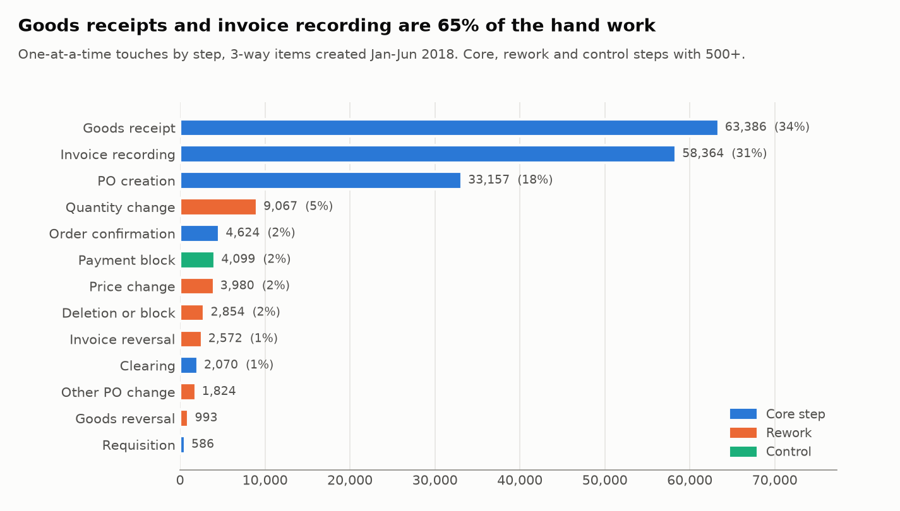

**One kind of rework costs time: a price changed after the invoice is in.** On 1,860 items (14.6% of value),
a payment block usually came off right after the change, often the same day. That looks like a match loop:
the invoice price didn't match the PO, so it was blocked until someone fixed the PO. Of the items that can
be timed, 92.2% were blocked, against 25.0% with no rework, and they cleared 4.0 days later than
comparable items. A price fixed before the invoice arrives isn't blocked more than usual. Quantity
changes are the most common rework, but they show no added wait.

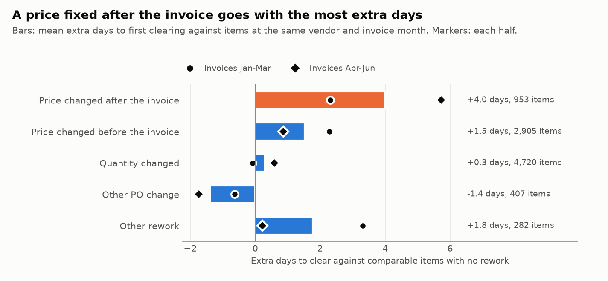

**Some rework is pure waste.** 4,448 items were deleted before anything was received or invoiced, mostly
by the buyer who raised them, within days. 2,621 items had an invoice cancelled and then recorded again.

| Rank | What to fix | Why |
|---|---|---|
| 1 | The late price-change loop | 1,860 items, 14.6% of value, +4.0 days and usually a block. Fix PO prices before the invoice arrives. |
| 2 | Invoice recording | 58,364 touches by 25 accounts, and late recording was 38.1% of overrun days in Part 3. Spread over 1,447 vendors, so it's e-invoicing or invoice capture for the whole team. |
| 3 | Order confirmations | Small, but 10 vendors send 75.7% of them, so taking them electronically is quick to reach. |
| 4 | POs withdrawn unused | 4,448 items. Ask buyers why on a sample, then decide if a duplicate check is worth it. |
| 5 | Quantity changes | The largest rework, but no added wait and concentrated at a few vendors. Check whether a scheduling agreement fits. |

### So what for the business?

- **Fix when the price is set, not how fast invoices clear.** The one piece of rework that delays payment
  is a PO price corrected after the invoice. Up-to-date contract prices, or an agreed price tolerance,
  stop the block before it starts. Packaging, the largest spend area, holds about a third of these items.
- **The biggest saving in hand work is invoice capture.** Invoice recording is nearly a third of all hand work, done by
  a small team, and it was a cause of late payments in Part 3. It's a whole-process project, not a few
  vendor deals.
- **Don't treat all rework as failure.** Quantity changes are the most common rework but show no added wait.
  Ask purchasing whether they're simply how rolling orders are managed before trying to cut them.
- **Ask for one thing first:** the reason codes behind blocks, deletions and invoice cancellations, if the
  system keeps them. They'd turn these inferences into facts.

**What this can't show:** how long each touch takes, so no cost in hours or money. "One at a time" is
inferred from timing, though a stricter bulk rule barely changes the big steps. The log doesn't say why
anything was changed, deleted or cancelled, and extra days compare similar items without proving cause.

## Plan

1. ✅ **Source, snapshot and profile.** Verified download, strict parser, data-quality traps.
2. ✅ **Compliance.** 21 rule checks in DuckDB SQL, each sized as a share of items, plus an explanation
   of the clearing gap and a review list.
3. ✅ **Bottlenecks.** A process map, waiting times that count unfinished items, and how much of the
   wait comes from terms, the run calendar and late steps.
4. ✅ **Rework and automation.** Changes, cancellations and repeat work by vendor and spend area,
   with bulk runs kept apart from hand work, turned into a ranked list of what to fix first.
5. **CI and write-up.** Automated checks, TL;DR, ranked recommendations and limitations.

## How to run

```bash
uv venv .venv && uv pip install -r requirements-lock.txt   # or: pip install -r requirements.txt
source .venv/bin/activate

python -m scripts.profile_log     # Part 1 report from the committed snapshot (about 25 seconds)
python -m scripts.compliance      # Part 2 report, rule table and review list (about 20 seconds)
python -m scripts.bottlenecks     # Part 3 report, tables and charts (about 20 seconds)
python -m scripts.rework          # Part 4 report, tables and charts (about 20 seconds)
pytest                            # about 4 minutes

# Optional, to rebuild the snapshot from the source:
python -m scripts.download_data   # 17-730 MB depending on the host, verified by MD5
python -m scripts.build_snapshot  # about 3 minutes
```

## Tests

210 tests. The headline numbers are recounted in plain pandas, with none of the project's SQL. Each
compliance rule also runs on a small hand-written log, so it can be seen both failing and passing,
including edge cases such as a Dutch midnight, a same-day receipt and a bulk run. The wait breakdown
and the rework flags are worked out by hand on small logs too, and the waiting-time estimate is
checked against a plain day-by-day loop on the real data. The parser and downloader are tested on small hand-written files,
including truncated and wrong copies. A rebuild from the raw log must match the committed files byte
for byte, and the reports and charts must match a fresh run. To check that the tests can fail, 98
bugs were planted one at a time, such as a wrong follow-up window or ignoring a reversal. 92 were
caught straight away. The other 6 showed gaps in the tests, so tests were added and they're now
caught too.

## Layout

```
data/              snapshot (events, cases) and SNAPSHOT.json with its hashes
p2p/               source details, XES parser, DuckDB helper, waiting-time estimate
scripts/           download, snapshot, profile, compliance, bottleneck and rework steps
sql/               table definitions and every query behind the report
results/           generated report and charts
tests/             pytest suite
```

## Credit

Data: van Dongen, Boudewijn (2019). *BPI Challenge 2019*. 4TU.ResearchData. Dataset.
https://doi.org/10.4121/uuid:d06aff4b-79f0-45e6-8ec8-e19730c248f1, licensed under
[CC BY 4.0](https://creativecommons.org/licenses/by/4.0/). The snapshot in `data/` is a CSV
conversion of that log with the `org:resource` field dropped, because it always equals `User`.
