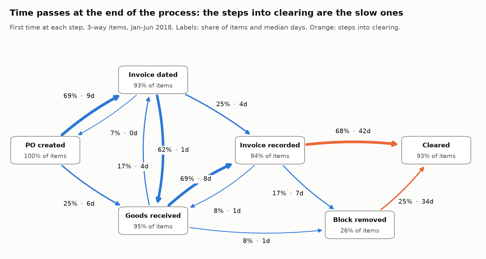
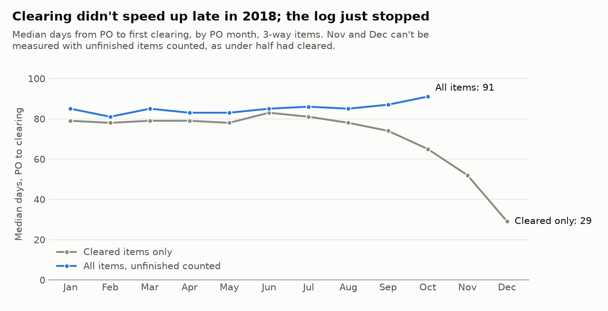
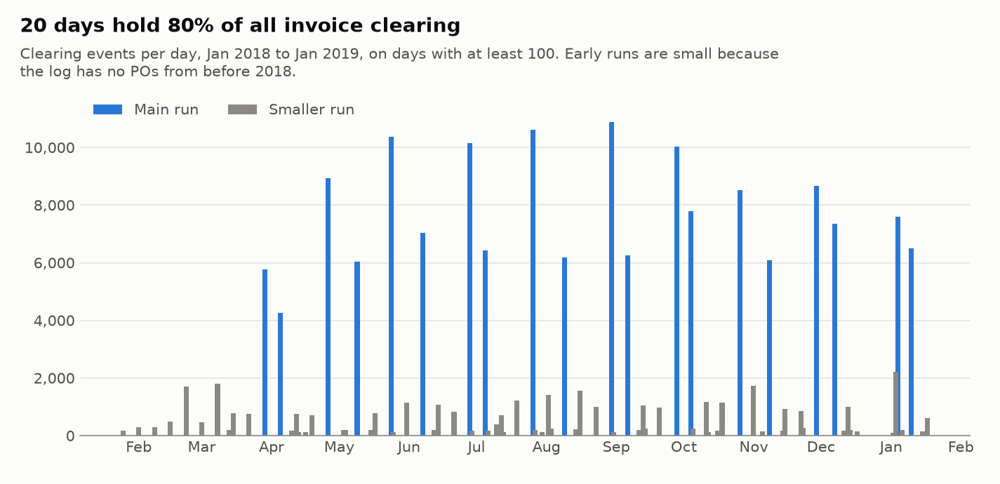
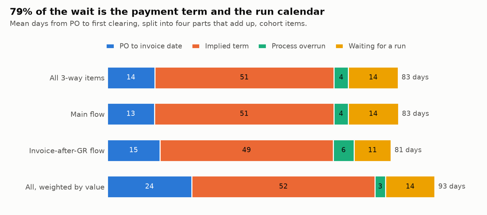

# Bottlenecks: where purchase items wait, and why

Generated by `scripts/bottlenecks.py` from the committed snapshot. Don't edit by hand.

Source: van Dongen, Boudewijn (2019). BPI Challenge 2019. 4TU.ResearchData. Dataset. https://doi.org/10.4121/uuid:d06aff4b-79f0-45e6-8ec8-e19730c248f1 Licence: CC BY 4.0.

This covers the two 3-way flows, which hold 93.9% of the items
created from 2018-01-01 up to, not including, 2018-07-01. Consignment has no invoices, and
the 2-way flow is covered in the compliance report. Times are Dutch calendar days, because vendor
dates have no time of day (3.2 in the source profile).

## 1. The answer

An item takes a mean 83.0 days from PO to first clearing. On the
105,356 items that can be measured, those days split like this:

| Part | Mean days | Share |
|---|---|---|
| PO to the vendor's invoice date | 13.6 | 16.3% |
| Implied payment term | 51.2 | 61.6% |
| Process overrun: a step finished after the invoice was due | 4.1 | 5.0% |
| Waiting for a payment run, already ready and due | 14.2 | 17.1% |

**Most of the wait looks agreed or scheduled, not stuck.** Only
13.8% of items were still unfinished when the invoice fell due. The
implied term comes from the data, not from the contracts, so section 5 tests it.

## 2. The process map

Each item's first time at six main steps, on 126,440 items. Repeats are left out, and an
invoice date goes first among same-day events, because the invoice exists before anyone records
it. Steps taken by at least 5% of items:

| From | To | Items | Share of items | Median days | 90th percentile days |
|---|---|---|---|---|---|
| PO created | Invoice dated | 87,865 | 69.5% | 9 | 33 |
| Goods received | Invoice recorded | 86,636 | 68.5% | 8 | 53 |
| Invoice recorded | Cleared | 85,728 | 67.8% | 42 | 94 |
| Invoice dated | Goods received | 77,920 | 61.6% | 1 | 5 |
| PO created | Goods received | 31,839 | 25.2% | 6 | 26 |
| Invoice dated | Invoice recorded | 31,157 | 24.6% | 4 | 44 |
| Block removed | Cleared | 31,137 | 24.6% | 34 | 98 |
| Goods received | Invoice dated | 21,205 | 16.8% | 4 | 17 |
| Invoice recorded | Block removed | 21,049 | 16.6% | 7 | 63 |
| Invoice recorded | Goods received | 10,523 | 8.3% | 1 | 6 |
| Goods received | Block removed | 10,360 | 8.2% | 1 | 5 |
| Invoice dated | PO created | 8,303 | 6.6% | 0 | 17 |

8,881 items (7.0%) have nothing cleared; the compliance report covers
why. The map shows where time passes, not why. The longest common step, invoice recorded to cleared,
is a median 42 days, but sections 4 and 5 show that's mostly the term and the run calendar.

## 3. Waiting times that count unfinished items

The log stops on 2019-01-18, so taking the median of items that have cleared favours the quickest
items in recent months. The Kaplan-Meier method (`p2p/survival.py`) keeps every item: one still open
when the log stops counts as waiting until that day, and deleted or never-invoiced items stay
counted as not cleared.

| PO month | Items | Cleared by the log's end | Median, cleared items only | Median, all items |
|---|---|---|---|---|
| Jan | 19,960 | 91.9% | 79 | 85 |
| Feb | 19,632 | 93.3% | 78 | 81 |
| Mar | 23,285 | 92.0% | 79 | 85 |
| Apr | 20,961 | 93.5% | 79 | 83 |
| May | 21,491 | 93.4% | 78 | 83 |
| Jun | 21,175 | 93.5% | 83 | 85 |
| Jul | 19,886 | 91.3% | 81 | 86 |
| Aug | 19,063 | 88.8% | 78 | 85 |
| Sep | 16,894 | 76.1% | 74 | 87 |
| Oct | 20,812 | 54.8% | 65 | 91 |
| Nov | 19,923 | 29.2% | 52 | not reached |
| Dec | 13,110 | 5.0% | 29 | not reached |

**There was no slowdown through September.** Counting all items, the median stays at
81-87 days from January to September. Cleared items alone would show
74 days in September falling to 29 in December, which is only the log
stopping. October is 91 days, a little higher. October POs reach clearing around the new
year, when main runs pause for 28 days, which may explain it. November and December can't be
measured, as under half of their items had cleared.

Every stage, on all 236,192 3-way items created in the log's span:

| Stage | Items | Unfinished | Median, finished only | Median, all items | 90th percentile, all items |
|---|---|---|---|---|---|
| PO to first goods receipt | 236,192 | 6.4% | 9 | 11 | 50 |
| PO to vendor invoice date | 236,192 | 11.4% | 9 | 11 | 140 |
| Invoice date to invoice recorded | 209,202 | 0.0% | 10 | 10 | 46 |
| Invoice recorded to first clearing | 210,692 | 13.1% | 42 | 45 | 101 |
| Goods receipt to first clearing | 221,013 | 17.3% | 63 | 66 | 114 |
| PO to first clearing | 236,192 | 22.4% | 77 | 85 | 164 |

The all-item median of 85 days from PO to clearing is above the 77 days for finished items because it
counts the items that clear slowly or not at all. It's above the 79.1 days in the source profile for the
same reason: that figure uses cleared items from the first half of 2018.

## 4. The payment calendar

| Days with clearing | Days | Clearing events | Share |
|---|---|---|---|
| Main runs | 20 | 155,406 | 79.9% |
| Smaller runs | 62 | 35,306 | 18.2% |
| Other days | 170 | 3,681 | 1.9% |

A main run clears at least 4,000 events in a day, and a smaller run at least
100. Early in the year the runs look small because the log holds no POs from before 2018.

- **20 days hold 79.9% of all clearing events.** On the 3-way cohort,
  81.2% of items first cleared on a main run, and
  85.8% on a Thursday.
- **There are two main runs a month from late March:** one early in the month and one near the end.
  The break is at year-end, with no main run between 7 December and 4 January, a gap of 28 days.
  Smaller runs fill most other Thursdays.
- **Most vendors belong to one of them.** Of 148 vendors with at least 100 items on main
  runs, 126 have at least 80% in one run.

| Vendor pattern | Vendors | Items on main runs |
|---|---|---|
| Tied to the late run | 78 | 46,262 |
| Tied to the early run | 48 | 24,228 |
| Both runs | 22 | 9,460 |

So a typical vendor's invoices wait for one run a month. An item arriving on a random day would wait
about 15 days for that, which is close to the 14.2 days measured below. That's a
cross-check, not an input.

## 5. Where the days go

The log has no payment terms or due dates, so each vendor's term is implied: the time from invoice
date to first clearing on its fastest 5% of invoices. The steps are:

1. **PO to invoice date.** Can be negative, when the invoice is older than the PO.
2. **Implied term.** Invoice date to the implied due day, or to clearing if that came first.
3. **Process overrun.** If goods, invoice recording or the block removal finished after the due day, the days until the last of them did.
4. **Waiting for a run.** Ready and due, not yet cleared.

They add up exactly, item by item. Means are used because medians don't add up.

| View | Items | Total | PO to invoice date | Implied term | Process overrun | Waiting for a run |
|---|---|---|---|---|---|---|
| All 3-way items | 105,356 | 83.0 | 13.6 | 51.2 | 4.1 | 14.2 |
| Main flow | 100,093 | 83.1 | 13.5 | 51.3 | 4.0 | 14.4 |
| Invoice-after-GR flow | 5,263 | 81.0 | 15.1 | 49.4 | 6.0 | 10.5 |
| Weighted by value | 105,356 | 93.5 | 24.2 | 52.2 | 3.0 | 14.0 |

Medians, for reference: 79 days in total, 9 to the invoice date, 49 for the term and
10 waiting for a run. Most items have no overrun. The value-weighted row shows larger
items spend longer before the invoice (24.2 days against 13.6), with the
later parts about the same.

**What's measured:** of 126,440 cohort items, 117,559 cleared. 4,693 of those have a
cancellation or debit memo and are left out, because their clearing may be a correction. 55 have no usable
invoice date. Another 7,455 are at vendors with under 30 items, leaving 105,356
(83.3% of the cohort) at 351 vendors.

### Is the implied term real?

Three checks, since this is the biggest number here and an inference:

- **It holds on later invoices.** With terms set on January to March invoices only, 181 vendors can be
  compared with April to June. The median change is 2 days, and 171 vendors
  (94.5%) move a week or less. Only 4.7% of later
  invoices beat the earlier term, close to the 5% expected.
- **It clusters.** Implied terms bunch at 35-41 and 56-62 days, which is what 30- and 60-day terms
  would look like with a few days' handling. 16 vendors at 84 days or more hold
  16.7% of items. That's suggestive, not proof.

| Implied term, days | Vendors | Items measured |
|---|---|---|
| Under 28 | 68 | 16,930 |
| 28-34 | 24 | 8,379 |
| 35-41 | 62 | 16,502 |
| 42-55 | 41 | 16,434 |
| 56-62 | 96 | 23,002 |
| 63-83 | 44 | 6,504 |
| 84 and over | 16 | 17,605 |

- **The split moves by only a few days when it's set differently.** Mixed terms by spend area don't change it.

| How the term is set | Items | Implied term | Process overrun | Waiting for a run |
|---|---|---|---|---|
| Fastest 1% | 105,356 | 48.7 | 4.6 | 16.1 |
| Fastest 5% (used) | 105,356 | 51.2 | 4.1 | 14.2 |
| Fastest 10% | 105,356 | 53.7 | 3.5 | 12.2 |
| Fastest 5%, per vendor and spend area | 103,395 | 51.2 | 4.1 | 14.2 |

## 6. What holds up the items that are late

14,553 items (13.8%) weren't finished when the invoice fell due:

| Last step to finish | Items | Share of measured items | Mean days late | Median days late | Share of overrun days |
|---|---|---|---|---|---|
| Payment block | 6,592 | 6.3% | 40.6 | 28 | 61.7% |
| Invoice recording | 7,916 | 7.5% | 20.8 | 11 | 38.1% |
| Goods receipt | 45 | 0.0% | 20.6 | 9 | 0.2% |

**Payment blocks are the largest cause.** They're behind 45.3% of late items but
61.7% of the days, as a blocked item runs later than one waiting for invoice recording.

The overrun is concentrated. Sales, Packaging and Trading & End Products hold
91.6% of overrun days, and 10 vendors hold
45.2% of them, out of 297 with any.

| Spend area | Items | Share of items | Items running late | Share of overrun days |
|---|---|---|---|---|
| Sales | 29,940 | 28.4% | 21.4% | 47.5% |
| Packaging | 49,752 | 47.2% | 8.1% | 30.2% |
| Trading & End Products | 9,918 | 9.4% | 24.4% | 13.9% |

Sales stands out: 28.4% of items but 47.5% of overrun days. More than 1 in 5 items run late in Sales and in
Trading & End Products, against 8.1% in Packaging.

## 7. What sets payment blocks?

A puzzle from the compliance work: 26.4% of main-flow items have a block removed, but only
7.1% of items with an invoice have it recorded on an earlier day than the goods. Going by the minute instead of the day
finds 10,972 items with the invoice first, and they're nearly always blocked. That
accounts for only 34.7% of blocks.

The log shows a block being removed, but very rarely being set, so this sorts main-flow items with an invoice by what's visible.
Each takes the first row that fits. "Extra days" compares blocked items with unblocked items at the same vendor with invoices dated in the
same month, so term and run are about the same.

| Signal | Items | Blocked | Blocked share | Share of blocks | Extra days to clear | Items compared |
|---|---|---|---|---|---|---|
| No reason visible in the log | 85,916 | 15,050 | 17.5% | 48.4% | +6.9 | 10,900 |
| Invoice recorded before the goods | 10,972 | 10,787 | 98.3% | 34.7% | -0.9 | 8,355 |
| PO price or quantity changed | 10,082 | 2,916 | 28.9% | 9.4% | +6.8 | 1,672 |
| Several invoices on the item | 3,940 | 1,885 | 47.8% | 6.1% | +35.3 | 419 |
| Invoice recorded between deliveries | 911 | 462 | 50.7% | 1.5% | +0.7 | 288 |

- **Blocks for an early invoice show no added wait.** The block does its job, with -0.9 days against
  comparable items.
- **48.4% of blocks have no visible reason,** and those add about 7 days. They may
  come from something the log doesn't record, such as a price tolerance. The unexplained block rate varies by vendor, from
  0% at the 10th percentile to 40% at the 90th (median 12%, 126 vendors with
  100+ items).
- **Items with several invoices show the largest gap,** but on only 419 items, and they differ from single-invoice items in other ways, so
  +35.3 days shouldn't be read as the block's effect.
- Across all compared items, a block goes with +4.4 days.

The estimate moves between the two halves of the cohort, so treat these as sizes, not exact figures:

| Signal | Invoices Jan-Mar | Invoices Apr-Jun |
|---|---|---|
| No reason visible in the log | +5.3 | +8.0 |
| Invoice recorded before the goods | +0.6 | -2.1 |
| PO price or quantity changed | +3.0 | +10.1 |
| Several invoices on the item | +48.6 | +25.3 |
| Invoice recorded between deliveries | +1.5 | +0.0 |

Accounts lifting blocks: named accounts make 22,902 removals, a median 6 days after the invoice was
recorded; batch accounts make 8,884, a median 3 days. Part 1 showed that named accounts
often work in bulk, so that gap isn't a measure of manual effort.

## 8. What this means

- **Don't read invoice-to-clearing time as a bottleneck.** A median 65 days from invoice date to clearing
  looks slow, but of the mean 69.4 days after the invoice date, 51.2 are the implied term. Reporting that as a process problem
  would send a team to fix the wrong thing.
- **The payment calendar is a decision, and it has a price either way.** Weekly Thursday runs would cut the wait from 14.2 to
  2.3 days, 11.8 days sooner for vendors. But cash would leave 11.6 days sooner too, weighted by value. Treasury should own that trade-off,
  not process improvement.
- **The real process fix is small and specific.** Overrun is 5.0% of the wait, on
  13.8% of items. Unexplained blocks and late invoice recording in Sales, Packaging and Trading are where to look.
- **Ask for one thing first:** the vendor master's payment terms. With real terms, sections 5 and 6 become exact.

## 9. Limits

- The implied term is an inference. If a vendor has been paid late on all but a few invoices, its real term is shorter than the implied one, and overrun is understated.
  If a vendor has mixed terms, its fastest 5% reflects the shortest, and the run wait is overstated. The sensitivity table bounds some of this.
- "Ready" means goods, invoice and block removal, as far as the log shows. Other checks, such as an approval outside this system, aren't visible.
- Vendor invoice dates are the vendor's, not the day the company received the invoice, so recording delays may include the post.
- The breakdown leaves out items that never cleared and corrected items. It describes normal items, and those are in the compliance report.
- Kaplan-Meier assumes items still open at the end behave like those that finished. Items from late in the year may not, given the new-year gap.
- Weekly what-if ignores public holidays and assumes each run would take every item that's ready and due.
- Extra days compare similar items but don't prove a block caused the difference.
