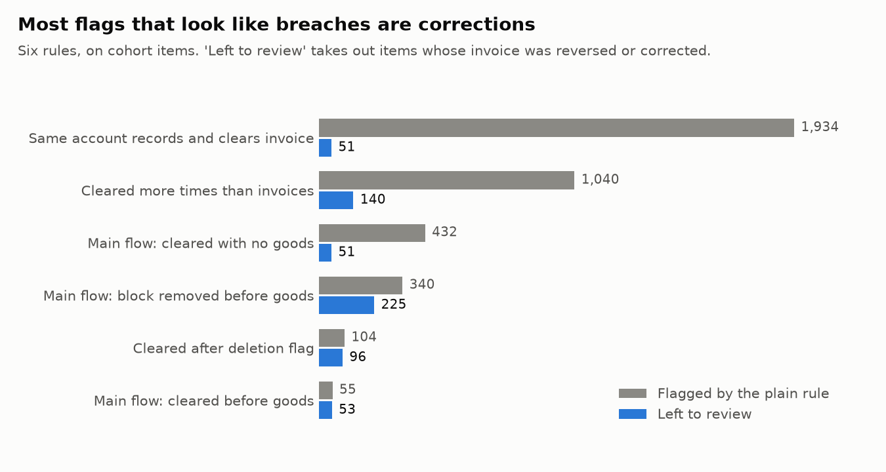
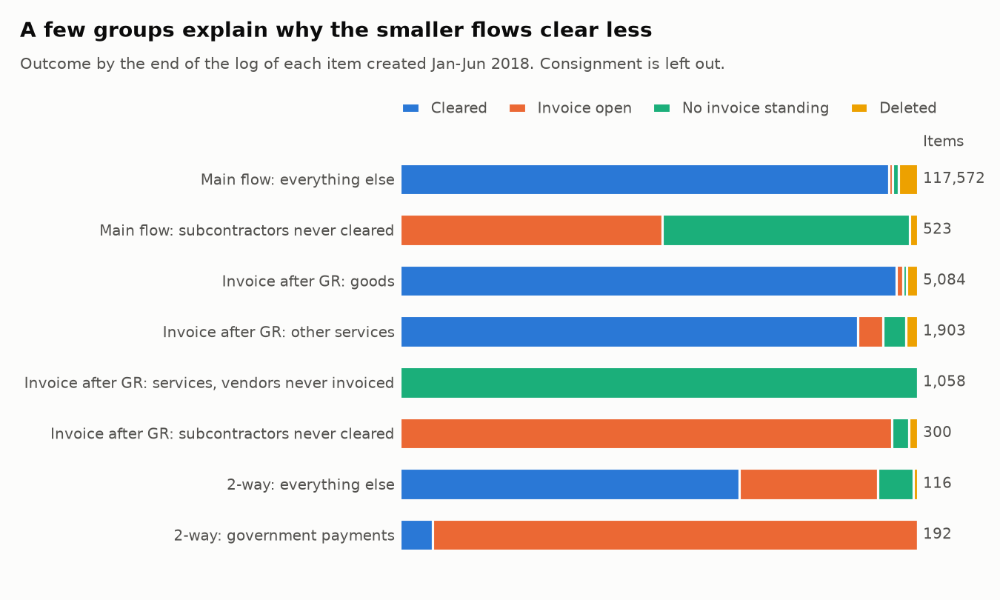

# Compliance: which rules held, and which need a closer look

Generated by `scripts/compliance.py` from the committed snapshot. Don't edit by hand.

Source: van Dongen, Boudewijn (2019). BPI Challenge 2019. 4TU.ResearchData. Dataset. https://doi.org/10.4121/uuid:d06aff4b-79f0-45e6-8ec8-e19730c248f1 Licence: CC BY 4.0.

## 1. How the rules were tested

- **Items, not events, on items with time to finish.** Rates use the 134,633 items created
  from 2018-01-01 up to, not including, 2018-07-01 (the cohort from the source profile).
  Items from 2018-07-01 up to 2018-10-01 are a second check, shown in the last column.
- **"Before" means an earlier calendar day.** Vendor dates and no-account clearing dates have no time of
  day, so a rule fails only when the day is earlier, in Dutch time.
- **Two sources of rule.** "Publisher" rules come from the dataset's description of each flow: on the
  main flow, invoices can arrive first but stay blocked until goods are received, and should be
  cleared only after that. Reading "blocked" as the log's payment block is an interpretation.
  "Audit test" rules are standard purchase-to-pay checks that the publisher doesn't state.
- **Flagged, then left to review.** "Flagged" is the plain reading of a rule. "Left to review" removes
  what the record itself explains, as listed for each rule. Removed items aren't proven fine.
- **Value is a share only** (see 3.1 in the source profile). The publisher's rule that values must match
  can't be tested, because the value field is stamped on each event.

| Flow | Items in the cohort | Share of items | Share of value |
|---|---|---|---|
| 3-way match, invoice before GR | 118,095 | 87.7% | 73.2% |
| 3-way match, invoice after GR | 8,345 | 6.2% | 25.6% |
| Consignment | 7,885 | 5.9% | 0.0% |
| 2-way match | 308 | 0.2% | 1.2% |

## 2. Controls that held

These 10 rules had no failures, in the cohort or the later check.

| Rule | Source | Items it applies to | Failures | Later items failing |
|---|---|---|---|---|
| Invoice-after-GR flow: invoice recorded before the goods | Publisher | 7,003 | 0 | 0 of 2,324 |
| Invoice-after-GR flow: cleared before or without goods | Publisher | 6,551 | 0 | 0 of 2,262 |
| Consignment: any invoice or clearing on the PO | Publisher | 7,885 | 0 | 0 of 3,330 |
| 2-way flow: any goods receipt | Publisher | 308 | 0 | 0 of 98 |
| 2-way flow: first approval after the invoice was recorded | Audit test | 299 | 0 | 0 of 96 |
| Goods receipt dated before the PO | Audit test | 128,267 | 0 | 0 of 56,036 |
| Invoice recorded before the PO | Audit test | 119,123 | 0 | 0 of 50,596 |
| Same account raised the PO and recorded the invoice | Audit test | 119,123 | 0 | 0 of 50,596 |
| Same account recorded the goods and the invoice | Audit test | 118,709 | 0 | 0 of 50,431 |
| Same account raised the PO and cleared the invoice | Audit test | 117,647 | 0 | 0 of 48,004 |

Where the system can enforce a rule, it looks enforced: neither invoice-after-GR rule has a single
exception. The remaining risk sits where a person or a batch can override the sequence, and in the
items these checks can't see.

## 3. Rules that need review

| Rule | Source | Applies to | Flagged | Taken out | Left to review | Share | Documents | Vendors | Largest vendor | Share of value | Share, later items |
|---|---|---|---|---|---|---|---|---|---|---|---|
| Main flow: cleared with no goods standing | Publisher | 111,008 | 432 | invoice reversed too | 51 | 0.05% | 44 | 25 | 22% | 0.08% | 0.08% |
| Main flow: cleared before the first goods receipt | Publisher | 110,662 | 55 | invoice reversed too | 53 | 0.05% | 20 | 18 | 51% | 0.24% | 0.04% |
| Main flow: payment block removed before goods | Publisher | 31,139 | 340 | invoice reversed too | 225 | 0.72% | 128 | 58 | 26% | 1.02% | 0.48% |
| Cleared before the invoice was recorded | Audit test | 117,411 | 19 | invoice reversed too | 10 | 0.01% | 9 | 5 | 30% | 0.01% | 0.01% |
| Cleared after the item was flagged deleted | Audit test | 117,647 | 104 | invoice reversed too | 96 | 0.08% | 90 | 59 | 12% | 5.68% | 0.02% |
| Cleared more times than invoices recorded | Audit test | 117,647 | 1,040 | cancellation or debit memo | 140 | 0.12% | 81 | 15 | 30% | 0.21% | 0.11% |
| 3-way flows: vendor invoice dated before the PO | Audit test | 117,409 | 1,766 | 7 days or less | 1,247 | 1.06% | 242 | 126 | 50% | 4.87% | 0.97% |
| 2-way flow: vendor invoice dated before the PO | Audit test | 299 | 264 | 7 days or less | 186 | 62.21% | 134 | 129 | 5% | 60.58% | 35.42% |
| Same account raised the PO and recorded the goods | Audit test | 128,267 | 2,706 | bulk runs | 2,673 | 2.08% | 1,815 | 313 | 19% | 12.85% | 2.30% |
| Same account recorded the invoice and cleared it | Audit test | 117,411 | 1,934 | cancellation or debit memo | 51 | 0.04% | 33 | 12 | 61% | 0.12% | 0.00% |
| Same account recorded the invoice and removed its block | Audit test | 32,452 | 993 | bulk runs, cancellation or debit memo | 232 | 0.71% | 85 | 56 | 16% | 0.66% | 0.75% |

"Largest vendor" is that vendor's share of the items left to review. "Share of value" is against the
value of the items the rule applies to.

## 4. "Cleared with no goods" is mostly reversals

Taken at face value, 432 main-flow items were cleared with no goods standing. But
381 of them (88%) have their invoice reversed as well, and 353
of those carry a debit memo.

| What happened | Items | With a debit memo |
|---|---|---|
| Goods never recorded; invoice reversed too | 337 | 319 |
| Goods cancelled; invoice reversed too | 44 | 34 |
| Goods cancelled; invoice stands | 42 | 3 |
| Goods never recorded; invoice stands | 9 | 0 |

With the invoice gone there's nothing left to pay, so `Clear Invoice` on these items most likely
closes out a correction. That's an inference: the log has no payment amounts. It does mean
`Clear Invoice` shouldn't be read as "paid" without checking for reversals.

The other 51 items (0.05% of cleared main-flow items)
have an invoice standing and no goods. That's the real size of this exception on this log.

## 5. Invoices older than their PO

| Flow | Items with a vendor invoice date | Dated before the PO | Share | Over 7 days | Over 30 days | Median gap |
|---|---|---|---|---|---|---|
| 3-way match, invoice before GR | 110,806 | 1,560 | 1.4% | 1.0% | 0.4% | 17 days |
| 3-way match, invoice after GR | 6,603 | 206 | 3.1% | 1.4% | 0.8% | 6 days |
| 2-way match | 299 | 264 | 88.3% | 62.2% | 16.1% | 18 days |

Vendor dates from 2017-01-01 onwards are used; the earlier ones are treated as typing errors.
An invoice dated before its PO suggests the PO was raised to fit an invoice, so the purchase wasn't
committed through the system first, unless the vendor's date is wrong. On the 3-way flows it's rare, though one vendor holds
50% of the items over 7 days. On the 2-way flow it's the norm.

## 6. Separation of duties

Only named accounts count, because batch accounts are automated. The table shows named accounts active on
cohort items, by duty.

| Pair of duties | Accounts on the first | Accounts on the second | On both |
|---|---|---|---|
| Raise PO / record invoice | 148 | 28 | 0 |
| Record goods / record invoice | 221 | 28 | 0 |
| Raise PO / clear invoice | 148 | 23 | 0 |
| Raise PO / record goods | 148 | 221 | 52 |
| Record invoice / clear invoice | 28 | 23 | 15 |
| Record invoice / remove block | 28 | 10 | 6 |

Purchasing and invoice processing don't overlap at all: no account does both, so those rules can't
fail. Overlap appears only inside each side:

- **PO and goods:** 2,673 items (2.08%), across 38 accounts, but
  12.9% of the value. `user_000` alone is 792 items. This is the one to look at:
  one person ordering and confirming receipt is the classic gap.
- **Invoice and clearing:** 1,934 items flagged, but 1,883 involve a cancellation or debit
  memo, which suggests a clerk closing out a correction. 51 are left.
- **Invoice and block:** 232 items left, across 2 accounts.

An account isn't proof of a person, and the log doesn't show any authorisation limits or sign-offs
behind these steps.

## 7. Why some flows clear less

The source profile left a question open: why do so few items clear on the 2-way and invoice-after-GR
flows? On the invoice-after-GR flow it's a few groups, not a general problem. The 2-way flow stays
low even without its largest group (section 8). Groups marked "never" were chosen because
none of their items cleared in the cohort, with at least 20 items per vendor, so they sit at
0% by construction. They show where the uncleared items are.

| Group | Items | Vendors | Cleared | Invoice open | No invoice standing | Deleted |
|---|---|---|---|---|---|---|
| Main flow: everything else | 117,572 | 1,252 | 94.4% | 769 | 1,475 | 4,320 |
| Main flow: subcontractors never cleared | 523 | 4 | 0.0% | 265 | 250 | 8 |
| Invoice after GR: goods | 5,084 | 153 | 95.8% | 68 | 37 | 109 |
| Invoice after GR: other services | 1,903 | 293 | 88.3% | 94 | 84 | 44 |
| Invoice after GR: services, vendors never invoiced | 1,058 | 9 | 0.0% | 0 | 1,058 | 0 |
| Invoice after GR: subcontractors never cleared | 300 | 2 | 0.0% | 285 | 10 | 5 |
| 2-way: everything else | 116 | 28 | 65.5% | 31 | 8 | 1 |
| 2-way: government payments | 192 | 149 | 6.2% | 180 | 0 | 0 |

| Flow | Cleared, all items | Cleared, without the groups above | Items left |
|---|---|---|---|
| 3-way match, invoice before GR | 94.0% | 94.4% | 117,572 |
| 3-way match, invoice after GR | 78.5% | 93.8% | 6,987 |
| 2-way match | 28.6% | 65.5% | 116 |

"Without the groups" leaves out the "never" groups and, on the 2-way flow, government payments.
1,358 items at 11 vendors are 76% of the 1,794 uncleared items on the
invoice-after-GR flow. Without them it clears at 93.8%, against 94.4% on the main flow.

- **Services that are received but never invoiced.** 9 vendors, 1,058 of 1,058 items in
  Logistics. All have service entry sheets (median 24), and on 1,044 items they all fall in one
  calendar month. None has an invoice on the PO. **Later items agree:** chosen on the cohort alone, the same
  vendors show 0 invoices on 536 items from 2018-07 to 2018-09. It looks like settlement outside
  this process, such as self-billing. The log can't confirm that.
- **Subcontractors with a late automated invoice.** 4 vendors. 561 of their cohort items
  have an invoice, and `Record Invoice Receipt` on 561 of them is a batch account. It lands a
  median 183 days after the PO, and 90% land between 183 and 200 days, which looks like a timed
  process rather than a vendor's bill. 0 have cleared. **The log stopping explains only part of this:** on other
  subcontracting items, 90% clear within 95 days of the invoice, and 308 of these
  invoices are older than that.

## 8. The 2-way flow is a separate process

Across the whole log, all 1,044 2-way items belong to one company, and they're the only items
that company has. `user_602` raised every one, and every one has an approval change. So this
flow is one entity's process, and it often runs in reverse: 88% of cohort invoices are dated before
the PO. In the cohort and the later check, approval came before the invoice was recorded every
time (section 2), but by design there's no goods check to fall back on.

- **Government payments** are 192 of 308 cohort items and 68% of the flow's value, across
  149 vendors. 12 have cleared and 180 are open, with 183 invoices recorded in March or April 2018.
- **Everything else** clears at 65.5%, with 31 invoices open.
- Open invoices on this flow have been waiting a median 288 days at the end of the log.

Either these are unpaid, or they're settled outside this log, and the log can't tell which. So the
clearing rate on this flow says nothing yet about payment performance.

## 9. The review list

[`review_list.csv`](review_list.csv) has 4,695 cohort items (3.5% of items) that any review rule
still flags, or 15.6% of cohort value. 241 of them fail two or more rules. It's sorted so
items failing the most rules come first, then the largest. It lists items to check, not proven breaches.

`cleared_after_delete` is small by count but not by value: 96 items hold
5.7% of the value of cleared items, and 94 of them are on EC purchase orders. A deletion flag
can close the rest of a line that's already been delivered, so a real invoice clearing after it can be
normal. They're worth a sample check because a few are very large.

## 10. What this means

- **The system controls work.** The invoice-after-GR flow's order is enforced, and no named account
  works on both purchasing and invoice processing.
- **Exceptions on the main flow are small.** All 3 main-flow rules fail on under 1% of the items they
  apply to, which calls for a targeted review, not a redesign.
- **Check reversals before reporting a breach.** On this log, most of the alarming counts were
  corrections. Without that step, "cleared with no goods" would be overstated about
  8 times.
- **Ask about what's outside the log.** Whether the 1,358 invoice-after-GR items and the 2-way
  government payments are settled elsewhere is one question for finance, and it decides most of the
  clearing gap.

## 11. Limits

- Value matching can't be tested, so a rule passing here says nothing about amounts.
- The log shows no approval limits, payment dates or bank payments.
- Same-day events count as in order, so these checks can miss a same-day breach.
- Item counts can overlap between rules. 241 items appear under more than one.
- The later check had 3.5 to 6.5 months of follow-up, so rates that depend on clearing can be low there.
