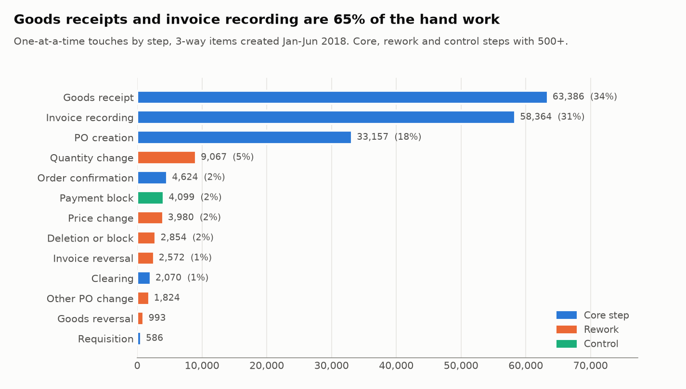
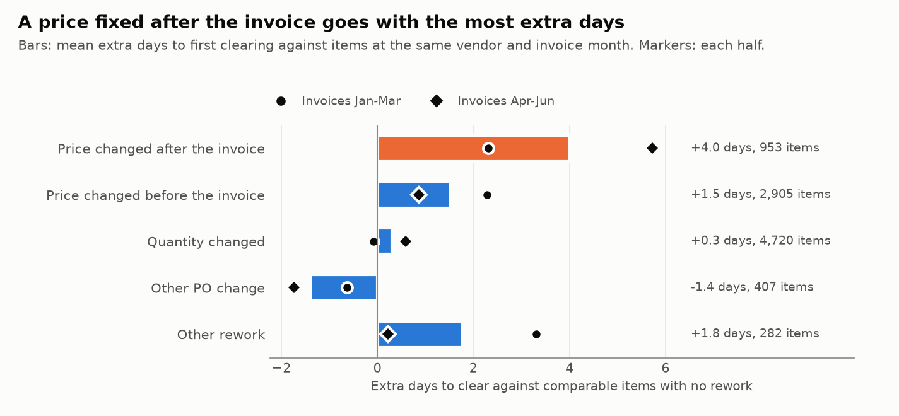

# Rework and automation: what gets redone, and what's still done by hand

Generated by `scripts/rework.py` from the committed snapshot. Don't edit by hand.

Source: van Dongen, Boudewijn (2019). BPI Challenge 2019. 4TU.ResearchData. Dataset. https://doi.org/10.4121/uuid:d06aff4b-79f0-45e6-8ec8-e19730c248f1 Licence: CC BY 4.0.

This covers the 126,440 items on the two 3-way flows created from 2018-01-01 up to, not including, 2018-07-01, as in the bottleneck report. Consignment has no invoices, and the 2-way flow is one login whose approval steps are part of its design.

Every event is sorted by how it was done:

- **System:** a batch account.
- **Vendor or none:** no account, such as the vendor's own invoice date.
- **Bulk:** a named account doing 50+ of the same thing in one minute, Part 1's rule for a run.
- **One at a time:** every other named-account event. This is the closest the log gets to hand work.

One-at-a-time work is counted in **touches**: one account handling one document in one minute counts once, however many lines it holds. A 10-line PO entered at once is one piece of work, not ten. The log has no task durations, so touches measure how often people step in, not hours.

## 1. The answer

- **18.9% of items have some rework** (23,901 of 126,440), holding 47.2% of value.
- **Most hand work is the core process, not rework.** There are 188,465 one-at-a-time touches in six months: 86.1% on core steps, 11.3% on rework and 2.3% on controls. Goods receipts and invoice recording alone are 64.6%.
- **One kind of rework costs time: a price changed after the invoice is in.** On 1,860 items, 92.2% of those measured were blocked, against 25.0% with no rework, and they cleared 4.0 days later than comparable items. A price changed before the invoice goes with +1.5 days and no extra blocking, and a quantity change with +0.3.
- **Some rework is pure waste.** 4,448 items were deleted before anything was received or invoiced, a median 1 day after the PO, and 2,621 items had an invoice cancelled and then recorded again.

## 2. How the work is done

| Step | Kind | Events | System | Bulk | One at a time | Vendor or none | Touches | Accounts |
|---|---|---|---|---|---|---|---|---|
| Goods receipt | Core | 163,050 | 27.1% | 5.6% | 67.4% | 0.0% | 63,386 | 221 |
| Invoice recording | Core | 132,657 | 5.6% | 3.2% | 91.2% | 0.0% | 58,364 | 25 |
| PO creation | Core | 126,440 | 8.1% | 7.4% | 84.5% | 0.0% | 33,157 | 147 |
| Quantity change | Rework | 11,237 | 0.0% | 0.0% | 100.0% | 0.0% | 9,067 | 135 |
| Order confirmation | Core | 14,790 | 19.1% | 1.9% | 79.0% | 0.0% | 4,624 | 6 |
| Payment block | Control | 33,498 | 26.8% | 44.3% | 28.8% | 0.0% | 4,099 | 10 |
| Price change | Rework | 7,335 | 0.0% | 4.3% | 95.7% | 0.0% | 3,980 | 109 |
| Deletion or block | Rework | 5,560 | 2.7% | 11.8% | 85.6% | 0.0% | 2,854 | 119 |
| Invoice reversal | Rework | 5,701 | 12.5% | 5.5% | 82.0% | 0.0% | 2,572 | 16 |
| Clearing | Core | 126,261 | 0.0% | 96.7% | 3.2% | 0.1% | 2,070 | 19 |
| Other PO change | Rework | 2,105 | 0.2% | 0.0% | 99.8% | 0.0% | 1,824 | 104 |
| Goods reversal | Rework | 1,657 | 22.9% | 0.0% | 77.1% | 0.0% | 993 | 89 |
| Other | Other | 6,820 | 88.6% | 0.0% | 11.4% | 0.0% | 733 | 13 |
| Requisition | Core | 976 | 35.8% | 0.0% | 64.2% | 0.0% | 586 | 23 |
| PO approval | Control | 3,714 | 0.0% | 54.1% | 45.9% | 0.0% | 156 | 36 |
| Vendor invoice | Core | 125,367 | 0.0% | 0.0% | 0.0% | 100.0% | 0 | 0 |
| Service entry sheet | Core | 92,514 | 0.0% | 0.0% | 0.0% | 100.0% | 0 | 0 |
| Vendor debit memo | Rework | 4,390 | 0.0% | 0.0% | 0.0% | 100.0% | 0 | 0 |

- **Clearing is already automated in practice:** 96.7% of clearing events are bulk runs, so the payment calendar, not people, sets its pace (Part 3).
- **Invoice recording is a small team's work.** 58,364 touches by 25 accounts, and 5 of them make 82.6%.
- **Goods receipts are spread out:** 63,386 touches by 221 accounts, so they're likely done by receiving staff across the business rather than one team.
- **Payment blocks are mostly lifted in bulk.** 71.2% of removals are bulk or system, leaving 4,099 touches.

## 3. How much is rework

| Rework | Items | Share of items | Share of value | Touches |
|---|---|---|---|---|
| Quantity change | 9,039 | 7.1% | 11.5% | 9,067 |
| Price change | 6,445 | 5.1% | 19.1% | 3,980 |
| Invoice reversal | 5,078 | 4.0% | 19.0% | 2,572 |
| Deletion or block | 5,076 | 4.0% | 11.7% | 2,854 |
| Vendor debit memo | 4,163 | 3.3% | 16.6% | 0 |
| Other PO change | 1,903 | 1.5% | 3.9% | 1,824 |
| Goods reversal | 1,340 | 1.1% | 11.1% | 993 |
| Any rework | 23,901 | 18.9% | 47.2% | - |

An item can have more than one kind, so the rows add up to more than the total. Debit memos come from the vendor and have no account, so they take no touches here, though someone has to deal with them.

**Bigger items are reworked more,** which is why the value share is well above the item share:

| Value fifth | Items | Value range | Items with rework |
|---|---|---|---|
| 1 | 25,288 | 0 to 143 | 11.6% |
| 2 | 25,288 | 144 to 367 | 11.9% |
| 3 | 25,288 | 367 to 951 | 14.5% |
| 4 | 25,288 | 951 to 3,213 | 22.8% |
| 5 | 25,288 | 3,214 to 8,833,459 | 33.7% |

## 4. The rework that costs time: a price changed after the invoice

Most PO changes happen before the first recorded invoice: 69.8% of price changes and 88.7% of quantity changes. The rest come after an invoice is recorded, and for prices that pattern is distinct.

**It looks like a match loop.** On 1,860 items a price was changed at or after the first recorded invoice. On 1,443 of them (77.6%) a payment block came off afterwards, 77.6% of those on the same day and 93.5% within a week. The likely reading is that the invoice price didn't match the PO, the invoice was blocked, someone corrected the PO, and the block was lifted. The log doesn't record why a block is set, so that's an inference. For comparison, 26.9% of main-flow items with an invoice and no price change were blocked.

These items are 1.5% of items but 14.6% of value. Packaging holds 31.6% of them, and the 10 vendors with the most hold 27.0%.

Extra days compare each item with items that had no rework at the same vendor with an invoice dated the same month, so term and run are about the same (the method from Part 3). Only items the wait breakdown measures are used, which leaves out corrected items, so reversals and debit memos can't be timed. Each item takes the first row that fits.

| Change | Items compared | Blocked | Extra days to clear | Extra overrun days | Invoices Jan-Mar | Invoices Apr-Jun |
|---|---|---|---|---|---|---|
| Price changed after the invoice | 953 | 92.2% | +4.0 | +2.9 | +2.3 | +5.7 |
| Price changed before the invoice | 2,905 | 25.9% | +1.5 | +0.1 | +2.3 | +0.9 |
| Quantity changed | 4,720 | 31.2% | +0.3 | -0.2 | -0.1 | +0.6 |
| Other PO change | 407 | 36.4% | -1.4 | -0.8 | -0.6 | -1.7 |
| Other rework | 282 | 31.2% | +1.8 | +0.1 | +3.3 | +0.2 |
| No rework | 86,679 | 25.0% | - | - | - | - |

- **A late price change goes with 4.0 more days,** 2.9 of them overrun past the due day. The size moves between the halves (+2.3 and +5.7), but it's positive in both.
- **A price fixed before the invoice arrives isn't blocked more than usual** (25.9%) and adds almost no overrun (+0.1 days). Its extra days to clear are smaller overall (+1.5), but in Jan-Mar they match the late change (+2.3 against +2.3). So the clearest difference is the blocks and the overrun, not the total days.
- **Quantity changes show no added wait** in either half, though they're the most common rework.
- These compare similar items but don't prove the change caused the difference.

## 5. Rework that's wasted effort

**POs deleted before they were used.** 4,787 items were deleted, and 4,448 of them (92.9%) had no goods and no invoice. They went a median 1 day after the PO, 73.3% within a week. Where one named account raised the item one at a time and a named account deleted it, it was the same account on 2,555 of 3,022 items (84.5%). That looks like buyers withdrawing their own POs soon after raising them, such as duplicates or wrong details, though the log doesn't say why.

**Invoices and receipts entered twice.** 4,810 items had an invoice cancelled, and 2,621 (54.5%) had one recorded again afterwards. 1,340 had a goods receipt cancelled, and 462 (34.5%) had goods recorded again. Cancelling and entering again is how a keying error is usually fixed, so many of these are likely entry mistakes, though some may be a corrected invoice from the vendor or a real return. The log can't tell them apart.

## 6. Where rework concentrates

Spend areas with at least 1,000 items:

| Spend area | Items | Share of items | Items with rework | Price changed after invoice | Rework touches per 1,000 items | Share of rework touches |
|---|---|---|---|---|---|---|
| Packaging | 54,754 | 43.3% | 16.8% | 587 | 155 | 39.8% |
| Sales | 34,161 | 27.0% | 13.5% | 267 | 81 | 13.0% |
| Trading & End Products | 12,711 | 10.1% | 36.2% | 181 | 281 | 16.8% |
| Additives | 8,399 | 6.6% | 20.0% | 218 | 224 | 8.8% |
| CAPEX & SOCS | 3,472 | 2.8% | 13.4% | 35 | 111 | 1.8% |
| Logistics | 2,676 | 2.1% | 15.2% | 136 | 332 | 4.2% |
| Latex & Monomers | 2,021 | 1.6% | 33.8% | 135 | 409 | 3.9% |
| Pigments & Colorants | 1,406 | 1.1% | 27.6% | 40 | 322 | 2.1% |
| Others | 1,346 | 1.1% | 16.8% | 14 | 159 | 1.0% |
| Solvents | 1,209 | 1.0% | 25.1% | 91 | 250 | 1.4% |
| (blank) | 1,205 | 0.9% | 38.8% | 31 | 454 | 2.6% |
| Specialty Resins | 1,035 | 0.8% | 30.0% | 59 | 291 | 1.4% |

Across all items there are 168 rework touches per 1,000 items. Trading & End Products stands out: 36.2% of its items have rework and it takes 281 touches per 1,000. In the Part 3 wait breakdown, 24.4% of its measured items ran late, against 13.8% across all areas.

**A few vendors drive much of it.** The 10 vendors with the most rework touches hold 27.3% of them. Of 183 vendors with at least 100 items, 13 have rework on half or more of their items, and they take 15.4% of rework touches. Quantity changes are the most concentrated rework: 10 vendors hold 38.8% of them.

## 7. What to automate or fix first

Every step done one at a time, by touches. The last two columns check how much of it is really one at a time: they count touches again with a stricter bulk rule, where an account handling 5 or more documents of the same step in a minute, or even 2, counts as bulk.

| Step | Kind | Touches | Share | Accounts | Vendors | Top 10 vendors' share | Under 5 documents a minute | One document a minute |
|---|---|---|---|---|---|---|---|---|
| Goods receipt | Core | 63,386 | 33.6% | 221 | 1,306 | 27.4% | 60,172 | 49,542 |
| Invoice recording | Core | 58,364 | 31.0% | 25 | 1,447 | 28.6% | 55,504 | 51,703 |
| PO creation | Core | 33,157 | 17.6% | 147 | 1,500 | 17.1% | 31,868 | 26,327 |
| Quantity change | Rework | 9,067 | 4.8% | 135 | 700 | 38.8% | 9,031 | 8,475 |
| Order confirmation | Core | 4,624 | 2.5% | 6 | 76 | 75.7% | 3,855 | 1,977 |
| Payment block | Control | 4,099 | 2.2% | 10 | 531 | 30.3% | 1,635 | 602 |
| Price change | Rework | 3,980 | 2.1% | 109 | 646 | 23.7% | 3,952 | 3,586 |
| Deletion or block | Rework | 2,854 | 1.5% | 119 | 447 | 39.0% | 2,840 | 2,424 |
| Invoice reversal | Rework | 2,572 | 1.4% | 16 | 579 | 17.3% | 2,227 | 2,034 |
| Clearing | Core | 2,070 | 1.1% | 19 | 487 | 27.0% | 1,302 | 975 |
| Other PO change | Rework | 1,824 | 1.0% | 104 | 318 | 32.5% | 1,818 | 1,635 |
| Goods reversal | Rework | 993 | 0.5% | 89 | 234 | 32.8% | 993 | 969 |
| Other | Other | 733 | 0.4% | 13 | 85 | 45.6% | 574 | 145 |
| Requisition | Core | 586 | 0.3% | 23 | 112 | 39.4% | 357 | 129 |
| PO approval | Control | 156 | 0.1% | 36 | 44 | 69.2% | 142 | 123 |

The stricter rule hardly changes the big steps, so their touches are real one-at-a-time work. Payment blocks are the exception: 4,099 touches fall to 602, so even these are mostly handled several at a time.

The order below weighs three things the table shows: how much hand work a fix removes, whether it also cuts delay (Part 3), and how few vendors or people it needs to reach.

1. **Stop the late price-change loop.** 1,860 items, 14.6% of value and 4.0 extra days, and 84.0% have a block removed. Each one is a price change plus, usually, a block to lift. Fix the PO price before the invoice arrives, by keeping contract prices in the system current or agreeing a price tolerance, starting with Packaging.
2. **Automate invoice recording.** 58,364 touches, 31.0% of all hand work, and late recording was 38.1% of overrun days in Part 3. It's spread over 1,447 vendors, with the top 10 at only 28.6%, so this means e-invoicing or invoice capture for the whole team, not a deal with a few vendors. It may also cut some of the 2,621 re-entered invoices.
3. **Take order confirmations electronically from the 10 vendors that send most of them.** 4,624 touches by 6 accounts, and 10 vendors account for 75.7%. 19.1% of confirmation events already come in through a system account, so the set-up may exist. It's small, but quick to reach.
4. **Find out why POs are withdrawn.** 4,448 items were deleted unused, mostly by the buyer who raised them, within days. Ask buyers for the reason on a sample first. If many are duplicates, a duplicate check at entry would stop them.
5. **Ask whether quantity changes are an error at all.** They're the largest rework, 9,067 touches, but add no wait and are concentrated: 10 vendors hold 38.8%. If those vendors deliver against rolling call-offs, a scheduling agreement would likely remove most of the changes. If not, they point to an ordering or planning problem worth a look.

Not ranked: goods receipts (63,386 touches by 221 accounts) and PO creation (33,157 by 147, top 10 vendors 17.1%) are the largest hand work, but they're spread across sites and buyers. Scanning at receiving, or catalogues for repeat buys, are operations projects to scope separately, not accounts-payable fixes.

## 8. Limits

- Touches count how often people step in, not how long it takes. A price change may take a minute or an hour of chasing a vendor, so any cost figure needs time studies or workflow data.
- "One at a time" is an inference from timing. A named account below 50 events a minute can still be running a tool, and section 7 checks how much that matters.
- The log doesn't say why something was changed, deleted or cancelled, so the readings of the price loop, the deleted POs and the re-entries are inferences.
- The value field is anonymised and stamped on each event (Part 1), so value shares are the only money measure, and a price change can't be sized.
- Extra days compare items at the same vendor and invoice month. They show what goes with a change, not what it causes.
