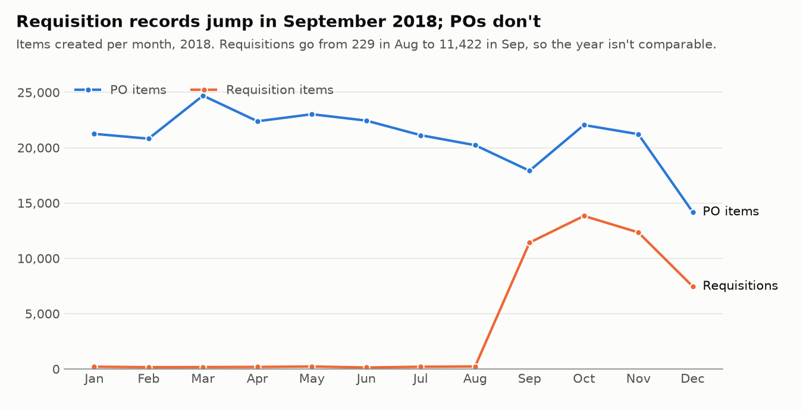
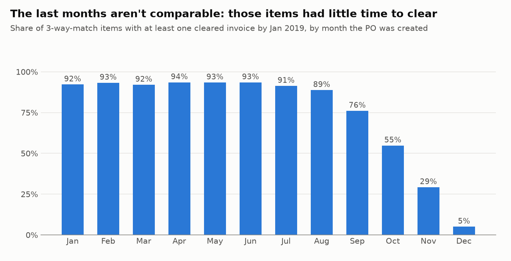
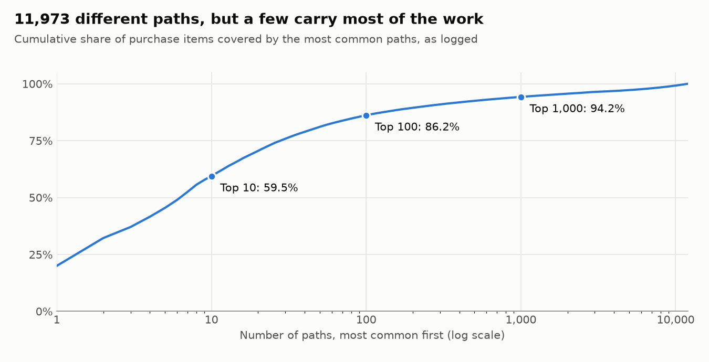

# Source profile: BPI Challenge 2019 event log

Generated by `scripts/profile_log.py` from the committed snapshot. Don't edit by hand.

Source: van Dongen, Boudewijn (2019). BPI Challenge 2019. 4TU.ResearchData. Dataset. https://doi.org/10.4121/uuid:d06aff4b-79f0-45e6-8ec8-e19730c248f1 Licence: CC BY 4.0.

## 1. The log at a glance

The log records the purchase-order handling of a large multinational in coatings and paints,
based in the Netherlands. One case is one purchase item (a line on a purchase order).

| | |
|---|---|
| Purchase items (cases) | 251,734 |
| Purchase documents | 76,349 |
| Events | 1,595,923 |
| Activities | 42 |
| Accounts | 607 named, 20 batch, plus `NONE` |
| Vendors | 1,975 |
| Companies | 4; one holds 99.6% of items |
| Main span | 2018-01-01 02:42 to 2019-01-18 13:34 UTC |
| Total item value | 996.8 million (anonymised scale, see 3.1) |
| Events per item | median 5, maximum 990 |

Items with more than 100 events: 822 (0.3% of items),
holding 10.5% of all events.

The log reconciles with the publisher's description:

| Count | This snapshot | Published | Match |
|---|---|---|---|
| Purchase items (cases) | 251,734 | 251,734 | yes |
| Events | 1,595,923 | 1,595,923 | yes |
| Purchase documents | 76,349 | 76,349 | yes |
| Activities | 42 | 42 | yes |
| Accounts (named + batch) | 627 | 627 | yes |

## 2. The four flows

Each item follows one of four routes, and each has its own rule for what must happen before an
invoice can be paid. The last column uses items created from 2018-01-01 up to, not
including, 2018-07-01, which have at least 6.5 months of follow-up.

| Flow | Items | Share of items | Share of value | Median item value | Median events | Cleared at least once |
|---|---|---|---|---|---|---|
| 3-way match, invoice before GR | 221,010 | 87.8% | 78.6% | 594 | 5 | 111,008 of 118,095 (94.0%) |
| 3-way match, invoice after GR | 15,182 | 6.0% | 20.1% | 405 | 6 | 6,551 of 8,345 (78.5%) |
| Consignment | 14,498 | 5.8% | 0.0% | 0 | 2 | 0 of 7,885 (0.0%) |
| 2-way match | 1,044 | 0.4% | 1.3% | 6,129 | 4 | 88 of 308 (28.6%) |

Consignment has no invoices on the PO by design, so 0 cleared is expected. Its items are also
14,498 of the 16,385 items with a value of exactly 0.
The low clearing share on the other flows is not explained here. It's a lead for the next part.

## 3. Seven ways to misread this log

### 3.1 The value field isn't real euros, and isn't cumulative

The field is called `Cumulative net worth (EUR)`, but:

- **It's anonymised.** The publisher applied a linear change that keeps 0 at 0. Shares and ratios
  hold; absolute amounts aren't real euros.
- **It doesn't accumulate, and it's repeated.** Adding it up across events gives
  28.55 billion, against 0.997 billion if each item is
  counted once: 28.6 times too much.
- **19 of the 25 activities with 1,000+ events always show the same value as
  the item's PO creation event**, including `Vendor creates invoice` and `Clear Invoice`. So those
  events say nothing about how much was invoiced or paid.
- **Even `Change Price` shows that same value.** It looks like one item-level figure stamped on
  each event, not a history of the price, so the effect of a price change can't be measured.

Among the same 25 activities, only these ever carry a different value:

| Activity | Events | Same as PO value |
|---|---|---|
| Record Invoice Receipt | 228,760 | 99.1% |
| Cancel Invoice Receipt | 7,096 | 99.0% |
| Remove Payment Block | 57,136 | 99.0% |
| Cancel Goods Receipt | 3,096 | 89.9% |
| Record Goods Receipt | 314,097 | 84.1% |
| Record Service Entry Sheet | 164,975 | 71.4% |

The publisher says invoices on one item should add up to the item's worth. Summing
`Record Invoice Receipt` does match the PO value on 200,455 of
211,379 invoiced items (94.8%).
But on 9,392 of the 9,644 items with several
receipts, every receipt shows the same value, so a sum would overshoot on those.

**Rule:** item value means the value on the PO creation event, counted once per item, and
results are given as shares. Any amount-matching check has to allow for repeated values.

### 3.2 Some vendor dates are wrong, and none has a time of day

327 events on 271 items fall outside the main span:
318 before it and 9 after, from
1948-01-26 to 2020-04-09. 320 of them are
`Vendor creates invoice` or `Vendor creates debit memo`, and the other
7 are requisitions from 2017. A late-2017 date can be real,
but the 95 before 2017 are very unlikely to be, on purchase orders from 2018.

Inside the span, every one of those vendor events falls at one of two UTC times:

| UTC time | Events | First day | Last day |
|---|---|---|---|
| 21:59 | 143,666 | 2018-03-25 | 2018-10-27 |
| 22:59 | 82,188 | 2018-01-02 | 2019-01-17 |

21:59 appears only during 2018 summer time, which began on 25 March and ended on 28 October,
and 22:59 only outside it. So both are 23:59 in the Netherlands: these are dates, not times.

The 7,941 `Clear Invoice` events with no account have the same shape:
7,941 of them sit at those times, on 6 days.

**Rule:** treat these events as dates. They can sort after a same-day event that really came
later, and they can't be used for durations shorter than a day.

### 3.3 Requisition records change in September 2018

PO items stay between 17,917 and
24,707 a month through November, then fall to
14,179 in December. Requisition items run at
136-229
a month to August, then 11,422 in September.
September to December hold 96.7% of the year's requisitions.

The log doesn't say why. It could be a real policy change or a change in what was captured.

**Rule:** don't compare "PO raised without a requisition" across this break, and don't report
it as a compliance trend without asking the process owner.

### 3.4 The log stops, so recent items look unfinished

| PO month | 3-way items | Cleared | Share |
|---|---|---|---|
| Jan 2018 | 19,896 | 18,340 | 92.2% |
| Feb 2018 | 19,632 | 18,310 | 93.3% |
| Mar 2018 | 23,285 | 21,430 | 92.0% |
| Apr 2018 | 20,961 | 19,606 | 93.5% |
| May 2018 | 21,491 | 20,078 | 93.4% |
| Jun 2018 | 21,175 | 19,795 | 93.5% |
| Jul 2018 | 19,886 | 18,162 | 91.3% |
| Aug 2018 | 19,063 | 16,923 | 88.8% |
| Sep 2018 | 16,895 | 12,852 | 76.1% |
| Oct 2018 | 20,814 | 11,399 | 54.8% |
| Nov 2018 | 19,921 | 5,823 | 29.2% |
| Dec 2018 | 13,109 | 656 | 5.0% |

On 3-way items from the first half of 2018, the median time from PO to first clearing is
79.1 days, and 10% take over 129.0 days. Items created
late in the year hadn't had that long when the log stopped.

**Rule:** measure outcomes and durations on items with enough follow-up, or use a method that
handles unfinished items. Don't read the fall as a slowdown.

### 3.5 A named account isn't always a person

The publisher describes named accounts as people and batch accounts as automated. The pattern in
the data is less clean. The last column counts named-account events sharing an activity, an
account and a minute with at least 50 events in all.

| Activity | Events | Named | Batch | No account | Named events in 50+ bursts |
|---|---|---|---|---|---|
| Record Goods Receipt | 314,097 | 72.9% | 27.1% | 0.0% | 7.1% |
| Create Purchase Order Item | 251,734 | 92.4% | 7.6% | 0.0% | 8.3% |
| Record Invoice Receipt | 228,760 | 95.9% | 4.1% | 0.0% | 3.6% |
| Clear Invoice | 194,393 | 95.9% | 0.0% | 4.1% | 97.0% |
| Remove Payment Block | 57,136 | 73.0% | 27.0% | 0.0% | 72.4% |

`user_002` alone clears 85.6% of all
invoices, on 94 days. That looks like bulk payment runs under one
login, not 166,353 manual steps, though the log can't confirm it.

**Rule:** "named" doesn't mean "manual". Estimates of manual workload have to separate bulk
runs from one-at-a-time work. If clearing happens in runs, its dates reflect the run calendar as
well as the invoice, which matters when timing the steps before it.

### 3.6 Same-minute ties and repeats inflate the number of paths

Timestamps stop at the minute, and 233,463 of 1,344,189 steps
(17.4%) share their minute with the step before.

| Paths counted | Number |
|---|---|
| As logged | 11,973 |
| Same-minute events in a fixed order | 11,825 |
| Also collapsing immediate repeats | 7,246 |

**Rule:** process-map counts are only a guide. Ties alone change little; collapsing repeats removes
39% of the paths.

### 3.7 Service entry sheets dominate event counts on a few items

`Record Service Entry Sheet` has 164,975 events on only 5,604
items. 33,221 sets of rows are identical on item, activity, minute and
value, giving 132,906 extra rows, and 90.9%
of those are service entry sheets. No rows were dropped: several lines on one sheet can
legitimately look like this.

**Rule:** count items, not events, and don't deduplicate rows.

## 4. How varied is the process?

11,973 paths as logged. 9,030 of them were followed by only one item.
The top 10 cover 59.5% of items and the top 100 86.2%.

| Rank | Path | Items | Share |
|---|---|---|---|
| 1 | Create Purchase Order Item > Vendor creates invoice > Record Goods Receipt > Record Invoice Receipt > Clear Invoice | 50,286 | 20.0% |
| 2 | Create Purchase Order Item > Record Goods Receipt > Vendor creates invoice > Record Invoice Receipt > Clear Invoice | 30,798 | 12.2% |
| 3 | Create Purchase Order Item > Record Goods Receipt | 12,214 | 4.9% |
| 4 | Create Purchase Order Item > Vendor creates invoice > Record Goods Receipt > Record Invoice Receipt > Remove Payment Block > Clear Invoice | 11,383 | 4.5% |
| 5 | Create Purchase Order Item > Receive Order Confirmation > Record Goods Receipt > Vendor creates invoice > Record Invoice Receipt > Clear Invoice | 9,694 | 3.9% |

Ranks 1 and 2 differ only in whether `Vendor creates invoice` sits before or after the goods
receipt. Given 3.2, that order is partly an artefact of a date-only field.

## 5. What this means for the analysis

The log can answer **which rules were followed, where items wait and how often work is redone**,
as counts and shares of items. It can't answer **how many real euros are at stake**, and its
clearing events don't show what was actually paid.
